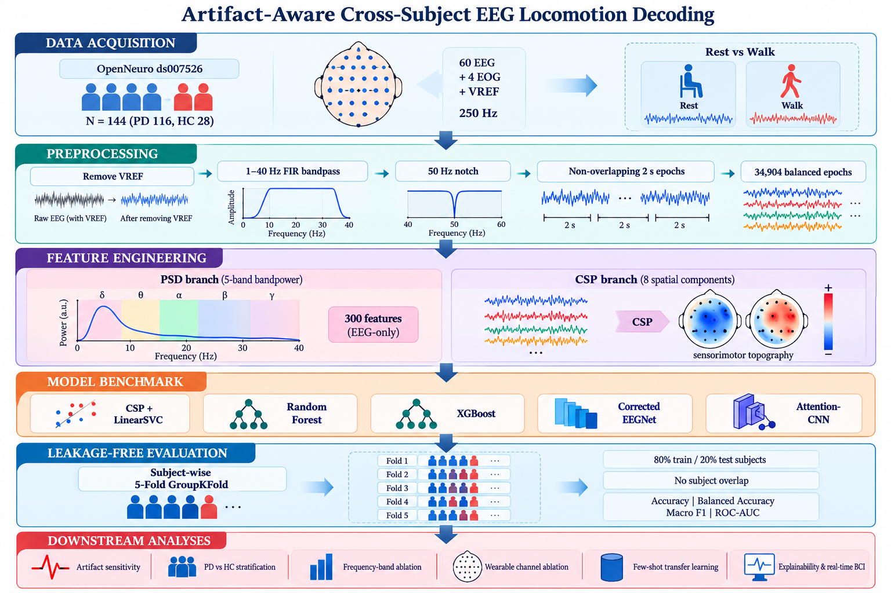

# Artifact-Aware Cross-Subject EEG Locomotion Decoding

[](https://www.python.org/downloads/)
[](https://openneuro.org/datasets/ds007526)
[](https://opensource.org/licenses/MIT)
[](https://www.kaggle.com/code/sajidshahriar72543/openneuro-ds007526-eda)

> **A Comparative Evaluation of Classical and Deep Learning Models with Clinical Neurodynamics**  
> *Under Review at Journal of Neuroscience Methods (Elsevier)*

---

## 📌 Overview

This repository hosts the canonical codebase, preprocessing pipelines, model architectures, and statistical validation scripts for our large-scale, artifact-aware benchmark of cross-subject EEG locomotion decoding.

Decoupling cortical gait dynamics from non-neural motion and ocular artifacts is a pivotal hurdle in developing non-invasive Brain-Computer Interfaces (BCIs) for lower-limb neurorehabilitation. Leveraging the public **OpenNeuro ds007526** cohort (**N=144** participants, **34,904 balanced epochs**), this work rigorously benchmarks five classifier families across subject-disjoint validation splits while empirically disproving artifact exploitation.



---

## 🔬 Key Scientific Findings

* **Phase-Invariant Spectral Features Outperform Deep Models:**  
  Transforming multi-channel temporal traces into 5-band Power Spectral Density (PSD) features elevates tree-based ensembles (**XGBoost: 92.43% ± 3.40%**, **Random Forest: 91.96% ± 3.36%**), decisively surpassing Common Spatial Patterns (80.97%) and deep convolutional architectures (EEGNet: 63.41%).
* **Empirical Disproof of "Artifact Cheating":**  
  Excluding ocular channels produced negligible performance variation ($\Delta = -0.24\%$, paired $t$-test $p = 0.737$). CSP spatial filters localized discriminative variance strictly over sensorimotor cortex ($C_z, C_3, C_4$).
* **Electrophysiological Carrier Identification:**  
  Systematic frequency band ablation isolated **gamma oscillations (30–45 Hz)** as the dominant neural substrate of locomotion intent ($87.58\%$ standalone accuracy).
* **Clinical Feasibility & Wearable Blueprint:**  
  Few-shot target calibration with just $20\%$ session data boosted cross-subject accuracy to **$96.45\% \pm 1.90\%$**. A 6-electrode montage achieved $69.16\%$ accuracy at **$0.55\text{ ms}$ inference latency**, demonstrating edge-feasibility for real-time exoskeletons.

---

## 📊 Benchmark Summary

| Model Family | Feature Representation | Accuracy (%) | Precision (%) | Recall (%) | F1-Score (%) | ROC-AUC (%) | Inference Latency (ms) |
| :--- | :--- | :---: | :---: | :---: | :---: | :---: | :---: |
| **XGBoost** | 5-Band PSD (300 feats) | **92.43 ± 3.40** | **92.51** | **92.43** | **92.41** | **96.95** | **0.55** |
| **Random Forest** | 5-Band PSD (300 feats) | **91.96 ± 3.36** | **92.05** | **91.96** | **91.94** | **96.72** | 3.12 |
| **CSP + LinearSVC** | Spatial Covariance (8 filters) | **80.97 ± 4.12** | 81.10 | 80.97 | 80.92 | 87.40 | 1.84 |
| **EEGNet** | Raw Temporal ($60 \times 500$) | **63.41 ± 5.21** | 63.80 | 63.41 | 63.15 | 68.20 | 4.25 |
| **Attention-CNN** | Raw Temporal ($60 \times 500$) | **62.80 ± 5.48** | 63.12 | 62.80 | 62.47 | 67.55 | 6.80 |

---

## 📁 Repository Structure

```plaintext
EEG_Locomotion_Decoding/
├── Experiment file/                    # Standalone experiment prototypes
│   ├── first eda.ipynb                 # Initial exploratory data analysis
│   ├── second training.ipynb           # Model training pipeline
│   ├── third statistical validation.ipynb
│   └── fourth experiment.ipynb
├── Notebook/                           # Comprehensive research notebooks
│   ├── Automated_Dataset_Insight_and_EDA.ipynb
│   ├── Model_Training_and_Benchmark.ipynb
│   ├── Final_Artifact_and_Statistical_Validation.ipynb
│   ├── Master_Research_Notebook.ipynb
│   └── paper_assets/                   # Exported publication metrics & CSVs
├── figures/                            # Publication-quality figures (Figs 1–11)
├── kaggle_run/                         # Reproducible cloud execution scripts
├── paper.tex                           # Canonical LaTeX manuscript
├── paper.pdf                           # Compiled manuscript document
├── references.bib                      # Verified BibTeX bibliography
├── .gitignore                          # Standardized research repository ignore rules
└── README.md                           # Documentation & quickstart guide
```

---

## 🛠️ Quickstart & Reproduction

### 1. Prerequisites
Clone the repository and install required Python packages:

```bash
git clone https://github.com/mahfuj735/EEG_Locomotion_Decoding.git
cd EEG_Locomotion_Decoding
pip install -r requirements.txt  # Or install dependencies below
```

Key dependencies:
```bash
pip install mne numpy scipy pandas scikit-learn xgboost torch matplotlib seaborn
```

### 2. Dataset Access
Download the BIDS-formatted **OpenNeuro ds007526** cohort:
* Repository URL: [https://openneuro.org/datasets/ds007526](https://openneuro.org/datasets/ds007526)
* Accession: `ds007526`
* Participants: 144 subjects (116 Parkinson's Disease, 28 Healthy Controls)

### 3. Execution Pipeline
1. Run `Notebook/Automated_Dataset_Insight_and_EDA.ipynb` for dataset verification and sensor mapping.
2. Run `Notebook/Model_Training_and_Benchmark.ipynb` for 5-Fold GroupKFold model evaluation.
3. Run `Notebook/Final_Artifact_and_Statistical_Validation.ipynb` for EOG ablation, CSP topographies, and frequency band masking.

---

## ✍️ Authors

* **Md. Mahfujul Karim Sheikh** (Corresponding Author)  
  *Department of Computer Science and Engineering, Northern University of Business and Technology Khulna, Bangladesh*  
  Email: [mahfujul_cse735@nubtkhulna.ac.bd](mailto:mahfujul_cse735@nubtkhulna.ac.bd)
* **Md. Shahriar Sajid**  
  *Department of Computer Science and Engineering, European University of Bangladesh, Dhaka, Bangladesh*  
  Email: [sajid@eub.edu.bd](mailto:sajid@eub.edu.bd)

---

## 📜 Citation

If you use this codebase or methodology in your research, please cite:

```bibtex
@article{sheikh2026artifact,
  title={Artifact-Aware Cross-Subject EEG Locomotion Decoding: A Comparative Evaluation of Classical and Deep Learning Models with Clinical Neurodynamics},
  author={Sheikh, Md. Mahfujul Karim and Sajid, Md. Shahriar},
  journal={Journal of Neuroscience Methods (Under Review)},
  year={2026}
}
```

---

## 📄 License

This project is licensed under the [MIT License](LICENSE).
